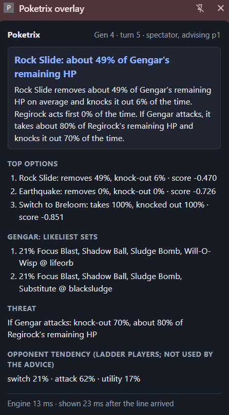

# Poketrix

A real-time decision engine for competitive Pokémon on Showdown (Generations 1–4, Random Battles).
Each turn it works out what the opponent's Pokémon probably is, what every option does to both sides,
and which option scores best, then says why in one checked sentence.

Every number comes from deterministic code, statistics or a data lookup. The text is written from
templates, and a guardrail rejects any sentence that cites a number the engine did not produce or a
move that is not legal this turn. No language model does arithmetic here; v1 uses none at all.



*The side panel on a Showdown replay: the advice, the top three options, the opponent's likeliest
sets, the threat and the opponent tendency.*

## Quickstart

```bash
python -m venv .venv
.venv\Scripts\activate                      # Windows  (source .venv/bin/activate elsewhere)
pip install -e ".[ml]"                      # [ml] adds NumPy and XGBoost for the opponent tendency
python -m poketrix analyze battle.log --turn 9    # one turn of your own saved battle log
python -m poketrix serve                    # the overlay's local server, on 127.0.0.1:8765 only
```

**The overlay:** with the server running, open `chrome://extensions`, turn on Developer mode, click
**Load unpacked** and choose the `extension/` folder. Pin Poketrix, then click it on Showdown to open
the side panel.
- On `replay.pokemonshowdown.com` it advises from player 1's side as the replay plays, so no live game is needed.
- In your own unrated battles it advises your side at every decision.

## Fair play

- **Off in rated battles.** When a live battle is rated, the server computes nothing and the panel
  says "Poketrix is off in rated battles". This is enforced in the server, not left to the extension.
- **Read-only.** It never sends a move or a switch, never touches your account or credentials, and
  only listens to the battle messages your own browser receives.
- **Local.** The server listens on 127.0.0.1 only and keeps nothing on disk (an optional debug log
  aside). The extension can reach exactly three hosts: the Showdown client, the replay site, and
  that local server.

Advice is available in unrated games, challenges and replays.

## How it works

```
battle messages ─► parser ─► GameState ─► uncloak ─► threats ─► offence ─► order ─► opponent ─► policy ─► text + guardrail
                  (Showdown                (Bayes over (their    (our moves (who     (heuristic-0; (one score
                   protocol)               known sets)  moves)    on them)   moves    xgb-1 shown   per legal
                                                                             first)   separately)   action)
```

- **Math:** one damage engine per generation reproduces Showdown's damage calculator roll for roll.
  KO odds are exact, with every roll, critical hit and accuracy check enumerated.
- **Uncloaker:** a Bayesian posterior over the opponent's set. The prior is 100,000 teams per
  generation sampled from Showdown's own Random Battle generator.
- **Turn engine:** a plain state machine. Each stage has a time budget and a fallback, and there is
  always a legal answer within 500 ms.
- **Opponent model:** XGBoost trained on 71,036 real ladder decisions. It is shown as the "opponent
  tendency" and is not used by the advice (see Known limits).

## Results

### Damage calculator against the oracle (`@smogon/calc` 0.12.0)

| Gen | Hand-picked cases | Random cases compared | Reported as unsupported instead |
|-----|-------------------|-----------------------|---------------------------------|
| 1 | 65 of 65 | 200 of 200 | — |
| 2 | 80 of 80 | 194 of 200 | Magnitude, Present, Triple Kick |
| 3 | 118 of 118 | 196 of 200 | Triple Kick, Present, Spit Up |
| 4 | 185 of 186 | 293 of 300 | Magnitude, Trump Card, Triple Kick, Spit Up, Rivalry |

Every compared case matches the stats and all normal and critical rolls exactly (39 rolls per list in
Gens 1–2, 16 in Gens 3–4). A move the engine cannot model is reported as unsupported, never guessed.

### Set uncloaker (held-out generated teams)

After one revealed move, then two:

| Gen | True set kept | Top-1 (1 move / 2 moves) | Top-3 (1 / 2) | Largest move calibration error |
|-----|---------------|--------------------------|---------------|--------------------------------|
| 1 | 100% | 0.672 / 0.772 | 0.950 / 0.973 | 0.0012 |
| 2 | 100% | 0.590 / 0.725 | 0.933 / 0.977 | 0.0029 |
| 3 | 100% | 0.524 / 0.665 | 0.884 / 0.950 | 0.0016 |
| 4 | 99.9975% | 0.497 / 0.629 | 0.860 / 0.933 | 0.0018 |

On 2,000 real replays, 0 of 13,177 ladder Pokémon contradicted every set the prior knows (the prior
was rebuilt from Showdown's source at commit `942cda7`).

### Battle-log parser (ground truth from simulated battles with known teams)

| Check | Result |
|-------|--------|
| Spectator evidence (moves, items, abilities, exclusions) | 0 false claims in 74,707 |
| Player mode, 500 battles per generation | 12,000 of 12,000 sets and spreads exact; 104,482 requests, 0 disagreements |
| Real replays | 2,000 of 2,000 parse (2 custom-rule games with 8-Pokémon teams refused by name) |

### Does the advice win games? (Phase 6)

The turn engine played in Showdown's own simulator. Every game was played twice with the teams
swapped, settings were tuned on one set of seeds, and the result was judged once on another.

| Match | Gen 1 | Gen 2 | Gen 3 | Gen 4 | All (95% interval) |
|-------|-------|-------|-------|-------|--------------------|
| Poketrix against the max-damage player | 68.7% | 79.5% | 81.0% | 80.3% | **77.4%** (76.1–78.6%) |
| Poketrix against the simulator's random player | 84.7% | 95.2% | 97.3% | 96.6% | 93.5% (92.6–94.2%) |
| Max-damage against the random player, for reference | 84.2% | 88.9% | 89.9% | 86.8% | 87.5% (86.4–88.4%) |

About 1,000 games per cell. Over 259,697 decisions, the simulator rejected none, none ended in an
error, and 95% took under 45 ms (the budget is 500 ms).

### Opponent model (Phase 7)

Predicting attack, utility move or switch on 188 held-out ladder battles (11,275 decisions):

| Predictor | Log-loss | Brier | Accuracy | Calibration error (ECE) |
|-----------|----------|-------|----------|-------------------------|
| Base rates per generation | 0.886 | 0.595 | 54.7% | 0.017 |
| heuristic-0 (the rule the advice uses) | 0.884 | 0.589 | 51.9% | 0.058 |
| **xgb-1** | **0.744** | **0.491** | **62.9%** | **0.016** |

The log-loss improvement is +0.142 over the base rates (95% battle-bootstrap interval +0.102 to
+0.170) and +0.140 over heuristic-0 (+0.107 to +0.166). xgb-1 is better than the base rates in every
generation. One prediction takes 0.28 ms.

### Overlay latency

From a battle message arriving to the advice being ready: p50 10 ms, p95 23 ms on the server
(337 decisions, opponent tendency included). The panel shows the full figure, browser included, for
every update.

## Known limits

- **Bots, not people.** Every win rate above is against simulator bots, and the max-damage player
  uses Poketrix's own estimate of the opponent's set. There has been no trial against human players
  yet. Gen 1 is the weakest generation.
- **The opponent tendency is information only.** Against bots, xgb-1 made the advice slightly worse
  (75.6% against 77.2%, paired difference −1.6 points), since it models ladder players and the
  max-damage bot never switches. The advice keeps heuristic-0, which is the version the win rates
  above validate.
- **Switch odds above 70% read "70%+".** The model's highest switch predictions are not reliable
  enough to print as a precise number.
- **Not modelled by the policy:** the opponent's priority moves, recoil, recharge turns, set-up moves
  and Gen 1 trapping moves. A self-KO move (Explosion and the like) is sometimes advised with a
  knock-out chance under 50%; the advice then says that it sacrifices your Pokémon.
- **Demo mode** gives player 1's Pokémon their likeliest sets, not their real ones.
- **Live play** depends on the Showdown client's page. A change there can stop the extension
  hearing the battle until it is updated.
- Gens 1–4 and singles only. Doubles and teams of more than six are refused.

## Development

```bash
pip install -e ".[dev,ml]"
pytest                  # every correctness test (the latency budgets are left out)
pytest -m timing        # latency budgets only: they depend on how busy the machine is
ruff check src tests
```

| # | Phase | Checkpoint |
|---|-------|------------|
| 0–2 | Scaffold, gen-aware schemas, offline dex | `cp-00` – `cp-02` |
| 3 | Damage engines for Gens 4 → 1, exact KO odds | `cp-03a/b/c` |
| 4 | Bayesian set uncloaker and threat report | `cp-04` |
| 5 | Showdown battle-log parser, spectator and player mode | `cp-05`, `cp-05b` |
| 6 | Turn engine: stages, score-based policy, templates and guardrail | `cp-06` |
| 7 | Opponent model xgb-1 | `cp-07` |
| 8 | Overlay: local server and read-only Chrome extension | `cp-08` |

`docs/PROGRESS_TRACKER.md` is the full logbook, with every measurement and decision.
`docs/CHECKPOINTS.md` describes the branch and tag workflow.
